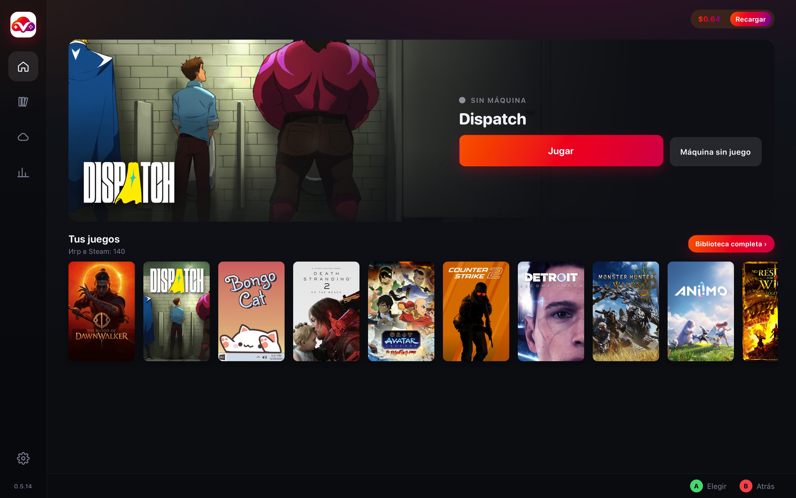

# VastGame

[English](README.md) · **Español** · [Русский](README.ru.md)

> **Beta.** Ya hay gente usándola, y todavía cambia. Si algo se rompe, escríbelo en [Issues](https://github.com/WetFoxx/Vast.ai-Cloud-Gaming-/issues).

VastGame sirve para jugar en una máquina alquilada de [Vast.ai](https://vast.ai) sin montarla de nuevo cada vez. Pulsas un juego de tu biblioteca de Steam y se abre la lista de máquinas. La máquina la eliges tú y confirmas el precio. Después del alquiler, Steam en la máquina descarga el juego y lo inicia, y Moonlight se abre solo. Las partidas, la sesión de Steam, los mods y los programas quedan en tu Google Drive y vuelven en la siguiente máquina. «Terminar» sube todo eso primero y solo entonces borra la máquina. Mientras no hay máquina, no se cobra nada.

El programa elige otra máquina por su cuenta solo cuando la que elegiste no arranca. Entonces la borra y toma la siguiente de tu lista que no sea peor en tarjeta, precio y ping. Mientras la máquina elegida arranca con normalidad, no se sustituye por otra.

**[Descargar para Mac](https://github.com/WetFoxx/Vast.ai-Cloud-Gaming-/releases/latest/download/vastgame-mac.dmg)**
(Apple Silicon, M1 o posterior)
·
**[Descargar para Windows](https://github.com/WetFoxx/Vast.ai-Cloud-Gaming-/releases/latest/download/VastGame-Setup.exe)**
(Windows 10/11, 64 bits)

Las compilaciones todavía no están firmadas por Apple ni por Microsoft, así que el sistema pide permiso la primera vez. Cómo darlo está en «Instalación».

## Cómo va una sesión

Primero va la configuración. El programa pide, paso a paso, la clave de Vast.ai, el acceso a Google y Tailscale. Steam, Moonlight y Steam Link los instala él mismo si todavía no están.

Entras en Steam en la página del propio Steam, con un código QR o con usuario y contraseña. VastGame no ve la contraseña. Puedes vincular varias cuentas, incluida una biblioteca familiar.

Al pulsar un juego en la estantería o en la biblioteca se abre la lista de máquinas. En la ficha del juego, antes de alquilar, eliges «Con mods» o «Sin mods». «Máquina sin juego» alquila el escritorio y no inicia ningún juego.

Después eliges la máquina y confirmas el precio. El programa la alquila, devuelve lo que hay en la nube, entra en la cuenta de Steam que toca, y Steam descarga e inicia el juego. Solo funciona una máquina a la vez. Otro juego en una máquina que ya está en marcha lo abres en Steam desde Moonlight. Para tomar otra máquina, pulsa primero «Terminar».

## Biblioteca

En la pantalla principal hay una estantería con los últimos juegos. «Biblioteca completa» muestra todos los juegos de las cuentas vinculadas, aunque el perfil de Steam esté cerrado. Los juegos de la familia van marcados, y hay búsqueda y filtro por cuenta.

En la ficha del juego se ve con qué cuenta se iniciará, si los mods están activos y qué hay ya en la nube. Si el acceso a Steam ha caducado, la lista de juegos se queda, y en la cuenta aparece que hay que entrar de nuevo.

## Lista de máquinas

En cada máquina de la lista se ven la tarjeta, el precio por hora, el país, el ping y la velocidad de internet. Los filtros y el orden se recuerdan. El disco se elige con un control de 50 a 1000 GB, y el precio por hora ya incluye ese tamaño.

La pestaña Docker está abierta por defecto. Hay más máquinas, y normalmente están listas en uno a tres minutos. El mando no vibra, y Vast cobra aparte el tráfico de la transmisión. El filtro «Tráfico» deja los hosts en los que ese tráfico sale barato.

KVM hace falta si quieres vibración o un tráfico casi gratis. Ahí hay pocas máquinas, y el arranque suele tardar de cinco a diez minutos.

Hasta que no has jugado en una máquina concreta, el ping se muestra aproximado, por la distancia de tu ciudad a la región del host. Después de la primera partida el programa recuerda una medición real por Tailscale y a partir de ahí muestra esa.

Si Vast no levanta la máquina elegida en diez minutos, o en Docker no arrancan la pantalla o el codificador, el programa la borra y toma la siguiente que sirva de tu lista. Si no hay ninguna, vuelves a la lista. Cancelar el arranque borra la máquina si ya estaba alquilada.

## La transmisión

La resolución por defecto es la nativa de tu monitor, y la tasa de bits está en automático: la calcula Moonlight. Los dos ajustes están en «Ajustes de transmisión», debajo del botón de inicio, y se recuerdan.

Al lado está Steam Link. La primera vez que esa cuenta no está vinculada a tu ordenador, se abre la ventana de Steam Link y un campo para cuatro cifras. VastGame envía el código a Steam en la máquina y guarda el vínculo en la nube. Si no tienes el cliente, en Mac se abre la App Store, y en Windows el programa instala Steam Link él mismo.

Por la ventana de VastGame se puede mover uno con el mando y las flechas. Mientras Moonlight levanta el flujo, la pantalla queda cubierta por la ficha del juego.

## Mods

A la nube no va el juego en sí. Va la diferencia entre su carpeta y una instalación limpia de Steam: lo que añadiste, cambiaste o borraste mientras el juego estaba cerrado. Los registros y la caché no se llevan. El juego lo vuelve a descargar Steam en cada máquina.

Hay un solo interruptor, y solo se puede cambiar antes de alquilar. Durante la sesión está cerrado y dice que se cambia antes de alquilar.

Con «Con mods», antes de iniciar se aplica el archivo de la nube sobre el juego limpio. Lo que cambie en la carpeta después de salir del juego se guarda y vuelve en la siguiente máquina.

Con «Sin mods» arranca una instalación limpia de Steam. El archivo de la nube se queda donde está, pero no se aplica al juego, y los mods nuevos de esta sesión no se guardan. Las partidas sí se suben como siempre.

Para poner mods, elige «Con mods» y alquila una máquina. Espera a que Steam instale el juego y ciérralo. Mientras está en marcha es mejor no tocar la carpeta, porque la foto del juego limpio se toma justo después de la instalación. Los archivos van a la carpeta del juego. Puedes descargarlos con Chrome en el escritorio de la máquina. El perfil del navegador, las contraseñas y los marcadores no se suben. Cuando sales del juego o pulsas «Terminar», los mods van a Google Drive. La próxima vez Steam vuelve a descargar el juego limpio y VastGame pone los mods encima. En la pantalla principal, en ese momento, dice que está aplicando los mods.

Mod Organizer, Vortex y los demás gestores se instalan como programas, no como archivos de un mod. Van en la sección siguiente.

Si Steam actualiza el juego en la misma sesión, los mods puestos ahora no se suben. Así los archivos viejos no caen sobre la versión nueva. En un juego que ya está actualizado se guardan con normalidad.

Los mods se quitan en «Juegos en la nube», en el grupo de mods, con «Quitar». El archivo permanece treinta días en la papelera de Google Drive y se puede recuperar. El juego y las partidas se quedan.

## Programas

Aquí entran trainers, WeMod, Mod Organizer, SKSE, Mod Engine, XIVLauncher y todo lo que deba abrirse al lado del juego o en su lugar.

De dónde pongas el programa depende si volverá en la siguiente máquina.

| Dónde lo pones | Qué se guarda |
|---|---|
| En la carpeta Programs del escritorio, cada programa en su carpeta | Se sube siempre y estará en la siguiente máquina |
| Directamente en la carpeta del juego | Se guarda con los mods, y solo si juegas «Con mods» |
| Con el botón «Instalar en el juego» | Queda en el prefijo Proton y se guarda con las partidas |

La máquina tiene que estar en marcha y el juego ya descargado. Descarga el archivo con Chrome en el escritorio y haz doble clic en el programa, el archivo comprimido o el instalador. VastGame reconoce el juego, pone el archivo en Programs o lo instala en el prefijo, y pregunta si hay que iniciarlo junto con el juego. También se puede hacer a mano: crea una carpeta dentro de Programs y mete ahí el programa. En aproximadamente medio minuto aparece en «Programas del juego», en la ficha. Si la lista está vacía, ahí mismo dice dónde poner los archivos.

«Iniciar» abre el programa en la misma sesión de Moonlight. Se cambia a su ventana con Alt+Tab. Un trainer necesita que el juego ya esté en marcha. Un gestor de mods puede arrancar en el prefijo aunque el juego esté cerrado.

«Con el juego» hace que se inicie junto con el juego, en esta máquina y en las siguientes.

«Inicio del juego» hace que Steam inicie el programa elegido en lugar del exe del juego. Así arrancan SKSE, Mod Engine y XIVLauncher. El Proton, las partidas y la cuenta siguen siendo los mismos. Funciona en el modo «Con mods», y la elección se recuerda. Mientras el juego ya está en marcha no se puede reiniciar Steam, así que la forma nueva entra después de salir del juego o en la siguiente máquina.

«Instalar en el juego» ejecuta el instalador una vez dentro del Proton de ese juego. El juego tiene que estar cerrado y ya instalado en Steam. La ventana del instalador se ve en Moonlight. Si después el juego debe arrancar a través de ese programa, elígelo en «Inicio del juego». Lo instalado se guarda con las partidas.

En la ficha de la versión gratuita de FINAL FANTASY XIV hay un interruptor aparte, «Traducción al ruso». Cuando está activo, la máquina instala XIVLauncher, Dalamud, Penumbra y la traducción, y en los alquileres siguientes actualiza la traducción si sale una versión nueva. El juego se inicia con XIVLauncher. En la cuenta de Square Enix entras tú. Todo eso se guarda con las partidas. Cuando el interruptor está apagado, el juego va con el launcher normal de Square Enix, y una traducción que ya esté en la nube no se borra.

Al lado está «Guardar el juego en la nube». Conviene activarlo en juegos con su propio launcher, como FF14 y otros MMO. Entonces los archivos que descargó el launcher llegan a la siguiente máquina y no hay que bajar el juego otra vez. A un juego normal de Steam ese interruptor no le aporta nada. Los mods, en cualquier caso, se guardan aparte.

## Juegos que no son de Steam

En el escritorio de la máquina hay una carpeta Games. Ahí se pone un juego comprado fuera de Steam. Cuando aparece una carpeta nueva, VastGame pregunta por encima de todas las ventanas si hay que llevársela a la nube. Si respondes que sí, se sube a Google Drive y se descarga en las máquinas siguientes. Si respondes que no, se queda solo en esta máquina y desaparece con ella. Si no respondes, un juego nuevo se sube igual. Lo que ya está en la nube no se borra solo porque quites la carpeta en la máquina. Se quita en «Juegos en la nube», y otra vez son treinta días en la papelera de Drive.

## Partidas guardadas

Las partidas se van a la nube tanto mientras juegas como cuando pulsas «Terminar». Entran las de Steam y los archivos que el juego escribe en su carpeta. En la siguiente máquina ya están ahí antes de iniciar.

Una partida se puede borrar en «Juegos en la nube». Si no hay copia en Steam Cloud, el juego no la devuelve, y el programa avisa de eso aparte.

Si cierras sesión de una cuenta de Steam en la propia máquina, sus datos locales salen de la sesión en la nube y no vuelven a la siguiente máquina. Los archivos de partidas de los juegos no se tocan.

## Cuando terminas

«Terminar» cierra el juego, manda a la nube todo lo que debe guardarse, espera la confirmación y solo entonces borra la máquina. Si la subida no se confirma, la máquina se queda y Vast sigue cobrando.

Si el Mac se apaga o se cae internet después de haber pulsado, la máquina termina la subida sola y se borra ella misma. Cuando vuelve la conexión, VastGame muestra que la sesión ya está cerrada.

«Borrar sin subir» está en los ajustes de la transmisión y pregunta dos veces. La máquina se borra al momento, y lo que todavía no había llegado a la nube se pierde.

## Qué hay en la nube

«Juegos en la nube» muestra lo que ya hay en tu Google Drive y cuánto ocupa. Ahí están los juegos, las partidas, los mods, los programas y los archivos de los launchers. Los archivos de servicio de Steam, como Proton y las bibliotecas compartidas, van plegados aparte. Hacen falta para que los juegos arranquen. Si los borras, Steam los descarga otra vez.

«Quitar» no borra el archivo al momento. Treinta días permanece en la papelera de Drive. Si hay una máquina en marcha, el borrado pasa por ella, para que no vuelva a subir el archivo. Si no hay máquina, el archivo va directo a la papelera.

## Qué hace falta

Hace falta un Mac con Apple Silicon, de M1 en adelante, o Windows 10/11 de 64 bits. Hace falta una cuenta de [Vast.ai](https://vast.ai) con dinero en el saldo. Para empezar bastan 5–10 dólares. Hace falta una cuenta de Google, adonde irán las partidas, los mods y los programas. Una cuenta aparte para los juegos es más cómoda que la principal. Hace falta [Tailscale](https://tailscale.com). Es gratis, y se puede entrar con Google. Tu propia clave no es obligatoria. La primera máquina la apruebas una vez, desde un enlace en el navegador, y después se levanta desde la identidad guardada. Conviene un internet de 30–50 Mbit/s o más, y tiene sentido mantener el ping por debajo de 80–100 ms.

«Recargar» solo abre el pago de Vast. El programa no ve la tarjeta y no cobra nada por su cuenta.

## Cuánto cuesta

El programa en sí es gratis. Pagas al dueño de la máquina en Vast.ai por el tiempo de alquiler. Los precios los ponen los dueños, y ahora vienen a ser estos.

| Tarjeta | Precio por hora |
|---|---|
| RTX 3060 | $0.07–0.15 |
| RTX 3080 | $0.13–0.25 |
| RTX 4090 | $0.40–0.60 |

En la pestaña Docker al precio por hora se le suma el tráfico. Lo que puede costar ese tráfico lo limita el filtro «Tráfico». Lo que se cobró de verdad está en «Historial», según las facturas de Vast.

## Instalación

En Mac, descarga [vastgame-mac.dmg](https://github.com/WetFoxx/Vast.ai-Cloud-Gaming-/releases/latest/download/vastgame-mac.dmg), ábrelo y arrastra VastGame a Aplicaciones. No hay firma de Apple, así que el sistema no deja abrir el programa la primera vez. Abre Ajustes del Sistema, entra en Privacidad y seguridad y, abajo, pulsa «Abrir de todas formas». Hace falta una sola vez. Después pasa la configuración en la ventana.

En Windows, descarga [VastGame-Setup.exe](https://github.com/WetFoxx/Vast.ai-Cloud-Gaming-/releases/latest/download/VastGame-Setup.exe) y ejecútalo. SmartScreen avisará de un editor desconocido. Pulsa «Más información» y luego «Ejecutar de todas formas». WebView2 en Windows 11 normalmente ya está instalado. La configuración a partir de ahí es la misma que en Mac.

Después el programa se actualiza solo. En la pantalla principal aparece que hay una versión disponible, y al lado el botón de actualizar. El archivo se comprueba con una firma, y una actualización ajena no se instala.

## Datos

VastGame no tiene servidor propio ni recoge estadísticas. Todo se ejecuta en tu ordenador. Las claves están en el Llavero de macOS o en el Administrador de credenciales de Windows. En Google Drive el programa solo ve la carpeta que creó él mismo.

Una máquina alquilada es el ordenador de otra persona, y el dueño del host tiene acceso mientras está en marcha. No dejes ahí nada personal. Para jugar es más tranquilo usar un Google aparte y, si no quieres usar el principal, un Steam aparte.

Más detalle está en la [política de privacidad](https://github.com/WetFoxx/Vast.ai-Cloud-Gaming-/blob/main/PRIVACY.md).

## Licencia

Los archivos de este repositorio se distribuyen bajo la licencia [MIT](https://github.com/WetFoxx/Vast.ai-Cloud-Gaming-/blob/main/LICENSE). Son el script de la máquina, la imagen Docker y estos textos. El programa para Mac y Windows se distribuye en las mismas condiciones, pero su código fuente no está en el repositorio. La licencia permite usarlo, copiarlo y modificarlo. El programa y el script se dan tal cual, sin garantía.
