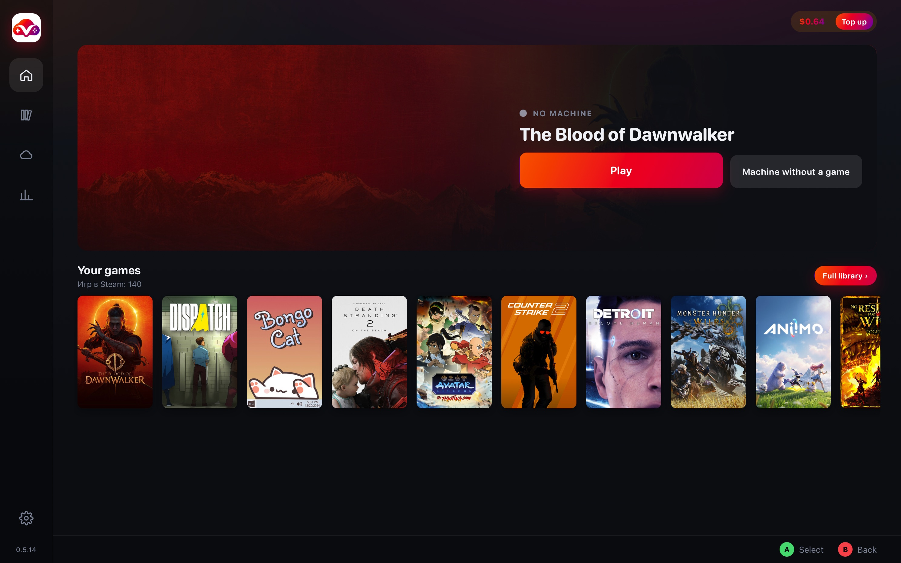

# VastGame

**English** · [Español](README.es.md) · [Русский](README.ru.md)

> **Beta.** People are already using it, and it is still changing. If something breaks, write in [Issues](https://github.com/WetFoxx/Vast.ai-Cloud-Gaming-/issues).

VastGame is for playing on a rented [Vast.ai](https://vast.ai) machine without setting that machine up again every time.

**[Download for Mac](https://github.com/WetFoxx/Vast.ai-Cloud-Gaming-/releases/latest/download/vastgame-mac.dmg)**
(Apple Silicon, M1 and newer)
·
**[Download for Windows](https://github.com/WetFoxx/Vast.ai-Cloud-Gaming-/releases/latest/download/VastGame-Setup.exe)**
(Windows 10/11, 64-bit)

The builds are not signed by Apple or Microsoft yet, so the system asks for permission on the first launch. How to allow it is in Installation below.

## A session

Setup comes first. The app asks, step by step, for a Vast.ai key, a Google sign-in and Tailscale. It installs Steam, Moonlight and Steam Link itself when they are missing.

You sign in to Steam on Steam’s own page, with a QR code or with a login and password. VastGame never sees the password. You can link several accounts, including a family library.

Pressing a game on the shelf or in the library opens the machine list. On the game card, before you rent, you choose With mods or Without mods. Machine without a game rents a desktop and does not launch a game.

You then pick a machine and confirm the price. The app rents it, restores what is in the cloud, signs in to the right Steam account, and Steam downloads and starts the game. Only one machine runs at a time. Another game on a machine that is already up is launched in Steam through Moonlight. To take a different machine, press Finish first.

## Library

The home screen shows a shelf of recent games. Full library lists every game on the linked accounts, even when the Steam profile is private. Family games are marked, and there is search and a filter by account.

The game card shows which account will launch it, whether mods are on, and what is already in the cloud. If the Steam sign-in has expired, the game list stays, and the account is marked so you can sign in again.

## The machine list

Each row shows the GPU, the hourly price, the country, the ping and the internet speed. Filters and sort order are remembered. Disk size is a slider from 50 to 1000 GB, and the hourly price includes that amount.

The Docker tab is the default. There are more machines, and they are usually ready in one to three minutes. The gamepad does not rumble, and Vast bills stream traffic separately. The Traffic filter keeps hosts where that traffic is cheap.

KVM is there when you want rumble or nearly free traffic. There are few of those machines, and a start more often takes five to ten minutes.

Until you have played on a particular machine, the ping is an estimate from the distance between your city and the host’s region. After the first session the app remembers a real measurement over Tailscale and shows that from then on.

If Vast has not brought the chosen machine up within ten minutes, or the screen or the encoder fails to start on Docker, the app deletes it and takes the next suitable one from your list. If there is none, you return to the list. Cancel start deletes the machine if it has already been rented.

## The stream

The default resolution is your monitor’s native resolution, and the bitrate is Auto, which Moonlight calculates. Both settings live under Stream settings below the launch button, and they are remembered.

Steam Link is the button next to it. The first time this account is not paired with your computer, the Steam Link window opens and VastGame asks for the four-digit PIN. It sends the code to Steam on the machine and stores the pairing in the cloud. If the client is missing, the Mac App Store opens, and on Windows the app installs Steam Link itself.

You can move around the VastGame window with a gamepad and the arrow keys. While Moonlight is bringing the stream up, the screen is covered by the game’s title card.

## Mods

What goes to the cloud is not the game itself. It is the difference between the game folder and a clean Steam install: files you added, changed or removed while the game was closed. Logs and cache are left out. Steam downloads the game again on every machine.

There is one switch, and it can be changed only before you rent. During a session it is locked, with the note that it changes before renting.

With mods, the archive from the cloud is applied on top of the clean game before launch. Changes in the folder after you leave the game are saved and come back on the next machine.

Without mods, you get a clean Steam install. The archive in the cloud stays where it is and is not applied, and new mods from this session are not saved. Game saves are still uploaded as usual.

To install mods, choose With mods and rent a machine. Wait until Steam has installed the game, then close it. Leave the folder alone while the game is running, because the snapshot of the clean install is taken right after installation. Put the files in the game folder. You can download them with Chrome on the machine’s desktop. The browser profile, passwords and bookmarks are not uploaded. When you leave the game or press Finish, the mods go to Google Drive. Next time Steam downloads a clean game again, and VastGame applies the mods on top. The home screen says it is applying mods while that happens.

Mod Organizer, Vortex and other managers are installed as programs, not as mod files. That is the next section.

If Steam updates the game during the same session, mods you added in that session are not uploaded, so old files are not laid onto the new version. On an already updated game they save as usual.

Mods are removed in Games in the cloud, in the mods group, with Remove. The file stays in the Google Drive trash for thirty days and can be restored. The game and its saves remain.

## Programs

This covers trainers, WeMod, Mod Organizer, SKSE, Mod Engine, XIVLauncher and anything else that should open beside the game or instead of it.

Where you put a program decides whether it comes back on the next machine.

| Where you put it | What is kept |
|---|---|
| In the Programs folder on the desktop, each program in its own folder | Always uploaded, and it will be on the next machine |
| Directly in the game folder | Kept with the mods, and only when you play With mods |
| Through Install into the game | Lands in the game’s Proton prefix and is kept with the saves |

The machine has to be running and the game already downloaded. Download the file with Chrome on the desktop and double-click the program, archive or installer. VastGame works out which game it belongs to, puts the file in Programs or installs it into the prefix, and asks whether to start it with the game. You can also do it by hand: make a folder inside Programs and put the program there. Within about half a minute it shows up in Programs of the game on the game card. If the list is empty, that same place tells you where to put files.

Start opens the program in the same Moonlight session. Alt+Tab switches to its window. A trainer needs the game to be running already. A mod manager can start in the prefix even while the game itself is closed.

With game turns on launching it together with the game, on this machine and on later ones.

Game launch makes Steam start the chosen program instead of the game’s exe. That is how SKSE, Mod Engine and XIVLauncher start. The Proton prefix, the saves and the account stay the same. It works in With mods, and the choice is remembered. Steam cannot be restarted while the game is already running, so the new launch takes effect after you leave the game or on the next machine.

Install into the game runs the installer once inside that game’s Proton. The game has to be closed and already installed in Steam. The installer window is in Moonlight. If the game should then start through that program, choose it under Game launch. What was installed is stored with the saves.

The free edition of FINAL FANTASY XIV has its own switch, Russian translation. When it is on, the machine installs XIVLauncher, Dalamud, Penumbra and the translation, and on later rentals it updates the translation when a new version is out. The game starts through XIVLauncher. You sign in to the Square Enix account yourself. All of this is stored with the saves. When the switch is off, the game uses the normal Square Enix launcher, and a translation already in the cloud is not deleted.

Keep the game in the cloud, next to it, is worth turning on for games that have their own launcher, such as FF14 and other MMOs. Files the launcher downloaded then come along to the next machine, and you do not download the game from scratch. A normal Steam game gains nothing from that switch. Mods are stored separately either way.

## Games that are not from Steam

The machine desktop has a Games folder. That is where a game bought outside Steam goes. When a new folder appears, VastGame asks, above every window, whether to take it to the cloud. Yes uploads it to Google Drive and downloads it on later machines. No leaves it only on this machine, and it disappears with the machine. If you do not answer, a new game is uploaded anyway. Something already in the cloud is not removed just because you delete the folder on the machine. You remove it in Games in the cloud, and it again sits in the Drive trash for thirty days.

## Saves

Saves go to the cloud both while you play and when you press Finish. That includes Steam saves and files the game writes into its own folder. On the next machine they are already there before launch.

You can delete a save in Games in the cloud. If there is no copy in Steam Cloud, the game will not bring it back, and the app warns you about that separately.

Signing out of a Steam account on the machine removes that account’s local data from the cloud session, so it does not come back next time. The save archives of the games are left alone.

## When you finish

Finish closes the game, uploads everything that should be kept, waits for confirmation, and only then deletes the machine. If the upload is not confirmed, the machine stays, and Vast keeps billing.

If the Mac shuts down or the connection drops after you have pressed the button, the machine finishes the upload itself and deletes itself. When the connection returns, VastGame shows that the session is already closed.

Delete without uploading is in the stream settings and asks twice. The machine is deleted immediately, and anything that had not reached the cloud is gone.

## What is in the cloud

Games in the cloud shows what is already in your Google Drive and how much space it takes. That is games, saves, mods, programs and launcher files. Steam’s own files, such as Proton and the shared libraries, are folded away on their own. They are needed to start games. If you delete them, Steam downloads them again.

Remove does not erase a file at once. It stays in the Drive trash for thirty days. If a machine is running, the deletion goes through it, so it does not upload the file back. If no machine is running, the file goes straight to the trash.

## What you need

You need a Mac with Apple Silicon, M1 or newer, or 64-bit Windows 10/11. You need a [Vast.ai](https://vast.ai) account with money on it. Five to ten dollars is enough to start. You need a Google account for the saves, mods and programs. A separate account for games is more convenient than your main one. You need [Tailscale](https://tailscale.com). It is free, and you can sign in with Google. Your own key is optional. You approve the first machine once, from a link in the browser, and after that it comes up from the saved identity. A connection of 30–50 Mbit/s or better is the practical floor, and it is worth keeping the ping under 80–100 ms.

Top up only opens Vast’s billing page. The app never sees the card and never charges it.

## What it costs

The app itself is free. You pay the machine’s owner on Vast.ai for the time it is rented. The owners set the prices. Right now they are roughly these.

| GPU | Price per hour |
|---|---|
| RTX 3060 | $0.07–0.15 |
| RTX 3080 | $0.13–0.25 |
| RTX 4090 | $0.40–0.60 |

On the Docker tab, traffic is added to the hourly price. The Traffic filter caps what that traffic may cost. What was actually charged is in History, from Vast’s bills.

## Installation

On a Mac, download [vastgame-mac.dmg](https://github.com/WetFoxx/Vast.ai-Cloud-Gaming-/releases/latest/download/vastgame-mac.dmg), open it and drag VastGame to Applications. There is no Apple signature, so the system will refuse the app the first time. Open System Settings, go to Privacy & Security, and at the bottom press Open Anyway. That is once. Then go through setup in the window.

On Windows, download [VastGame-Setup.exe](https://github.com/WetFoxx/Vast.ai-Cloud-Gaming-/releases/latest/download/VastGame-Setup.exe) and run it. SmartScreen will warn about an unknown publisher. Press More info, then Run anyway. WebView2 is usually already installed on Windows 11. Setup from there is the same as on a Mac.

After that the app updates itself. The home screen shows that a version is available, with an Update button next to it. The file is checked against a signature, and an update that does not match is not installed.

## Data

VastGame has no server of its own and collects no statistics. Everything runs on your computer. Keys are kept in the macOS Keychain or in Windows Credential Manager. In Google Drive the app can see only the folder it created.

A rented machine is someone else’s computer, and the host’s owner can reach it while it is running. Do not leave anything personal on it. For games it is calmer to use a separate Google account and, if you would rather not use your main one, a separate Steam account.

More of this is in the [privacy policy](https://github.com/WetFoxx/Vast.ai-Cloud-Gaming-/blob/main/PRIVACY.md).

## License

The files in this repository are under the [MIT](https://github.com/WetFoxx/Vast.ai-Cloud-Gaming-/blob/main/LICENSE) license. That is the machine script, the Docker image and these documents. The Mac and Windows application is distributed on the same terms, and its source code is not in this repository. The license allows use, copying and modification. The application and the script are provided as is, without warranty.
