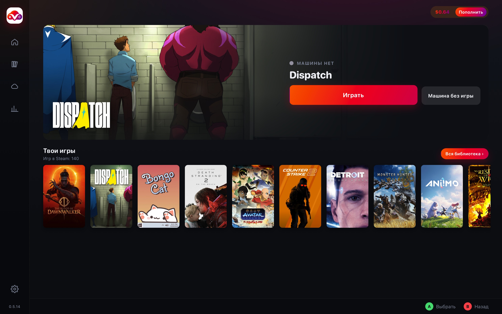

# VastGame

[English](README.md) · [Español](README.es.md) · **Русский**

> **Бета.** Программой уже пользуются, но она ещё меняется. Если что-то сломалось, напиши в [Issues](https://github.com/WetFoxx/Vast.ai-Cloud-Gaming-/issues).

VastGame нужен, чтобы играть на арендованной машине [Vast.ai](https://vast.ai) и не собирать её заново каждый раз.

**[Скачать для Mac](https://github.com/WetFoxx/Vast.ai-Cloud-Gaming-/releases/latest/download/vastgame-mac.dmg)**
(Apple Silicon, M1 и новее)
·
**[Скачать для Windows](https://github.com/WetFoxx/Vast.ai-Cloud-Gaming-/releases/latest/download/VastGame-Setup.exe)**
(Windows 10/11, 64 бит)

Сборок с подписью Apple и Microsoft пока нет, поэтому при первом запуске система спросит разрешение. Как его дать, написано в разделе «Установка».

## Как проходит игра

Сначала идёт настройка. Программа по шагам просит ключ Vast.ai, вход в Google и Tailscale. Steam, Moonlight и Steam Link она ставит сама, если их ещё нет.

В Steam входишь на обычной странице Steam, по QR-коду или логином с паролем. Пароль VastGame не видит. Можно привязать несколько аккаунтов, в том числе семейную библиотеку.

Когда нажимаешь на игру на полке или в библиотеке, открывается список машин. На карточке игры до аренды выбираешь «С модами» или «Без модов». Кнопка «Машина без игры» арендует рабочий стол и сама игру не запускает.

Дальше выбираешь машину и подтверждаешь цену. Программа арендует её, возвращает то, что лежит в облаке, входит в нужный аккаунт Steam, и Steam скачивает и запускает игру. 

## Библиотека

На главном экране лежит полка последних игр. «Вся библиотека» показывает все игры привязанных аккаунтов, даже если профиль Steam закрыт. Семейные игры помечены, есть поиск и фильтр по аккаунту.

На карточке игры видно, каким аккаунтом она запустится, включены ли моды и что уже лежит в облаке. Если вход в Steam устарел, список игр остаётся, а на аккаунте написано «войди заново».

## Список машин

У каждой машины в списке видны видеокарта, цена часа, страна, пинг и скорость интернета и стоимость трафика за 1ТБ. Фильтры и сортировка запоминаются. Размер диска задаётся ползунком от 50 до 1000 ГБ, и цена часа считается уже с этим объёмом.

Вкладка Docker открыта по умолчанию. Машин там больше, и обычно они готовы за одну–три минуты. Вибрации геймпада нет, а за трафик трансляции Vast берёт отдельно. Фильтр «Трафик» оставляет хосты, на которых этот трафик стоит недорого.

KVM нужен, если хочется вибрацию или почти бесплатный трафик. Машин там мало, и старт чаще занимает от пяти до десяти минут.

Пока ты на конкретной машине не играл, пинг показан приблизительно, по расстоянию от твоего города до региона хоста. После первой игры программа запоминает настоящий замер через Tailscale и дальше показывает его.

Если Vast не поднял выбранную машину за десять минут или на Docker не завёлся экран либо кодировщик, программа удаляет её и берёт следующую подходящую из твоего списка. Если такой нет, ты возвращаешься к списку. «Отменить запуск» удаляет машину, если она уже арендована.

## Трансляция

Разрешение по умолчанию совпадает с разрешением твоего монитора, а битрейт стоит на «Авто», и его подбирает Moonlight. Оба параметра лежат в «Параметрах трансляции» под кнопкой запуска и запоминаются. Там можно выбрать нужное разрешение и битрейт. Более глубокая настрйка стрима уже непосредственно в самом Moonlight.

Рядом есть Steam Link. Когда этот аккаунт ещё не привязан к твоему компьютеру, открывается окно Steam Link и поле для четырёх цифр. VastGame передаёт код в Steam на машине и сохраняет привязку в облако. Если клиента нет, на Mac откроется App Store, а на Windows программа поставит Steam Link сама. Перед началом игры через Steam Link, рекомендую настроить трансляцию в приложении Steam Link либо в Steam на хосте.

По окну VastGame можно ходить геймпадом и стрелками.

## Моды

!!!МОДЫ НЕОБХОДИМО УСТАНАВЛИВАТЬ КОГДА ИГРА ВЫКЛЮЧЕНА И ОБНОВЛЕНА!!!

В облако уходит не сама игра, а то, чем её папка отличается от чистой установки Steam. Туда попадает всё, что ты добавил, изменил или удалил, пока игра была закрыта. Журналы и кэш программа не забирает. Саму игру Steam каждый раз скачивает заново.

Тумблер один, и переключить его можно только до аренды. Пока идёт сессия, он закрыт и написано «Меняется перед арендой».

Если выбрано «С модами», перед запуском архив из облака ложится на чистую игру. То, что изменится в папке после выхода из игры, сохранится и приедет на следующую машину.

Если выбрано «Без модов», запускается чистая установка Steam. Архив в облаке остаётся на месте, но на игру не накладывается, и новые моды этой сессии не сохраняются. Сохранения игры при этом выгружаются как обычно.

Чтобы поставить моды, выбери «С модами» и арендуй машину. Дождись, пока Steam установит игру, и закрой её. Пока она запущена, папку лучше не трогать, потому что снимок чистой игры снимается сразу после установки. Файлы клади в папку игры. Скачать их можно через Chrome на рабочем столе машины. Профиль браузера, пароли и закладки в облако не уезжают. Когда выйдешь из игры или нажмёшь «Закончить», моды уйдут в Google Drive. В следующий раз Steam снова скачает чистую игру, а VastGame наложит моды сверху. На главном экране в этот момент написано «Накладываю моды».

Mod Organizer, Vortex и другие менеджеры ставятся как программы, а не как файлы мода. Про них следующий раздел.

Если Steam обновил игру в той же сессии, моды, поставленные сейчас, не выгружаются. Так старые файлы не попадут на новую версию. На уже обновлённой игре они сохраняются как обычно.

Удаляются моды в разделе «Игры в облаке», в группе «моды», кнопкой «Убрать». Тридцать дней файл лежит в корзине Google Drive, и его можно вернуть. Игра и сохранения остаются.

## Программы

Сюда относятся трейнеры, WeMod, Mod Organizer, SKSE, Mod Engine, XIVLauncher и всё, что должно открываться рядом с игрой или вместо неё.

От того, куда ты положил программу, зависит, вернётся ли она на следующую машину.

| Куда положил | Что сохранится |
|---|---|
| В папку Programs на рабочем столе, каждую программу в свою папку | Уедет в облако всегда и будет на следующей машине |
| Прямо в папку игры | Уедет вместе с модами и только если играешь «С модами» |
| Через кнопку «Установить в игру» | Окажется в префиксе Proton и сохранится вместе с сохранениями |

Машина должна быть запущена, а игра уже скачана. Скачай файл через Chrome на рабочем столе и дважды щёлкни по программе, архиву или установщику. VastGame сам определит игру, положит файл в Programs или поставит его в префикс и спросит, запускать ли его вместе с игрой. Можно сделать это и руками: создай папку внутри Programs и положи программу туда. Примерно через полминуты она появится в списке «Программы игры» на карточке. Если список пуст, там же написано, куда класть файлы.

«Запустить» открывает программу в той же сессии Moonlight. Переключиться на её окно можно через Alt+Tab. Трейнеру нужна уже запущенная игра. Мод-менеджер может стартовать в префиксе и тогда, когда сама игра закрыта.

«С игрой» включает запуск вместе с игрой на этой машине и на следующих.

«Запуск игры» заставляет Steam запускать выбранную программу вместо exe игры. Так стартуют SKSE, Mod Engine и XIVLauncher. Proton, сохранения и аккаунт остаются теми же. Это работает в режиме «С модами», и выбор запоминается. Пока игра уже запущена, Steam перезапустить нельзя, поэтому новый способ вступит после выхода из игры или на следующей машине.

«Установить в игру» один раз проводит установщик внутри Proton этой игры. Игра должна быть закрыта и уже стоять в Steam. Окно установки видно в Moonlight. Если после установки игра должна стартовать через эту программу, выбери её в «Запуск игры». Поставленное хранится вместе с сохранениями.

На карточке бесплатной версии FINAL FANTASY XIV есть отдельный тумблер «Русский перевод». Когда он включён, машина сама ставит XIVLauncher, Dalamud, Penumbra и перевод, а на следующих арендах обновляет перевод, если вышла новая версия. Игра запускается через XIVLauncher. В аккаунт Square Enix входишь сам. Всё это хранится вместе с сохранениями. Когда тумблер выключен, игра идёт обычным лаунчером Square Enix, а уже скачанный перевод из облака не удаляется.

Рядом стоит «Хранить игру в облаке». Его имеет смысл включать у игр со своим лаунчером, таких как FF14 и другие MMO. Тогда файлы, которые докачал лаунчер, приедут на следующую машину, и качать игру заново не придётся. Обычной игре из Steam этот тумблер ничего не даёт. Моды в любом случае хранятся отдельно.

## Игры не из Steam

!!!VAST.AI НЕ ОДОБРЯЕТ ИСПОЛЬЗОВАНИЕ ТОРРЕНТОВ И ЕСТЬ РИСК ПОЛУЧЕНИЯ БАНА, ПОЭТОМУ РЕКОМЕНДУЮ СКАЧИВАТЬ СТОРОННИЕ ИГРЫ ДРУГИМИ СПОСОБАМИ!!!

На рабочем столе машины есть папка Games. Туда кладут игру, купленную не в Steam. Когда появляется новая папка, VastGame спрашивает поверх всех окон, забирать ли её в облако. Если ответить «да», она уедет в Google Drive и скачается на следующих машинах. Если ответить «нет», она останется только на этой машине и пропадёт вместе с ней. Если не ответить, новая игра всё равно выгрузится. То, что уже лежит в облаке, само не сотрётся, даже если папку на машине удалить. Убрать её можно в «Играх в облаке», и снова на тридцать дней в корзине Drive.

## Сохранения

Сохранения уезжают в облако и во время игры, и когда нажимаешь «Закончить». Туда попадают и сохранения Steam, и файлы, которые игра пишет в свою папку. На следующей машине они уже на месте до запуска.

Удалить сохранение можно в «Играх в облаке». Если копии нет в Steam Cloud, игра его не вернёт, и программа предупреждает об этом отдельно.

Если выйти из аккаунта Steam прямо на машине, его локальные данные уберутся из облачной сессии и на следующую машину не приедут. Архивы сохранений игр при этом не трогаются.

## Когда заканчиваешь

«Закончить» закрывает игру, отправляет в облако всё, что должно сохраниться, дожидается подтверждения и только потом удаляет машину. Если выгрузка не подтвердилась, машина остаётся, и Vast продолжает списывать деньги.

Если Mac выключился или пропал интернет уже после нажатия, машина доделывает выгрузку сама и удаляет себя. Когда связь вернётся, VastGame покажет, что сессия закрыта.

«Удалить без выгрузки» лежит в параметрах трансляции и спрашивает дважды. Машина удаляется сразу, а то, что ещё не успело уехать в облако, пропадает.

## Что лежит в облаке

В «Играх в облаке» видно, что уже есть в твоём Google Drive и сколько это занимает. Там игры, сохранения, моды, программы и файлы лаунчеров. Служебные файлы Steam, такие как Proton и общие библиотеки, свёрнуты отдельно. Они нужны, чтобы игры запускались. Если их удалить, Steam скачает их заново.

«Убрать» не стирает файл сразу. Тридцать дней он лежит в корзине Drive. Если машина в этот момент работает, удаление идёт через неё, чтобы она не выгрузила файл обратно. Если машины нет, файл уходит в корзину напрямую.

## Что понадобится

Нужен Mac на Apple Silicon, от M1 и новее, или Windows 10/11 на 64 бита. Нужен аккаунт [Vast.ai](https://vast.ai) с деньгами на балансе. Для начала хватит 5–10 долларов. Нужен аккаунт Google, куда поедут сохранения, моды и программы. Отдельный аккаунт для игр удобнее основного. Нужен [Tailscale](https://tailscale.com). Он бесплатный, и войти можно через Google. Свой ключ не обязателен. Первую машину один раз одобряешь по ссылке в браузере, а дальше она поднимается из сохранённой личности. Интернет лучше от 30–50 Мбит/с, а пинг имеет смысл держать до 80–100 мс.

Кнопка «Пополнить» просто открывает оплату Vast. Номер карты программа не видит и сама ничего не списывает.

## Сколько это стоит

Сама программа бесплатная. Платишь владельцу машины на Vast.ai за время аренды. Цены ставят хозяева машин, и сейчас они примерно такие.

| Видеокарта | Цена часа |
|---|---|
| RTX 3060 | $0.07–0.15 |
| RTX 3080 | $0.13–0.25 |
| RTX 4090 | $0.40–0.60 |

На вкладке Docker к цене часа добавляется трафик. Его стоимость ограничивает фильтр «Трафик». Сколько списалось на самом деле, видно в «Истории», по счетам Vast.

## Установка

На Mac скачай [vastgame-mac.dmg](https://github.com/WetFoxx/Vast.ai-Cloud-Gaming-/releases/latest/download/vastgame-mac.dmg), открой его и перетащи VastGame в «Программы». Подписи Apple нет, поэтому система в первый раз программу не пустит. Открой «Системные настройки», зайди в «Конфиденциальность и безопасность» и внизу нажми «Всё равно открыть». Это нужно один раз. После этого пройди настройку в окне.

На Windows скачай [VastGame-Setup.exe](https://github.com/WetFoxx/Vast.ai-Cloud-Gaming-/releases/latest/download/VastGame-Setup.exe) и запусти его. SmartScreen напишет про неизвестного издателя. Нажми «Подробнее», затем «Выполнить в любом случае». WebView2 на Windows 11 обычно уже установлен. Настройка дальше такая же, как на Mac.

Потом программа обновляется сама. На главном экране появляется «Доступна версия», и рядом кнопка «Обновить». Файл проверяется подписью, и чужое обновление не установится.

## Данные

У VastGame нет своего сервера и нет сбора статистики. Всё выполняется на твоём компьютере. Ключи лежат в Связке ключей на Mac или в Диспетчере учётных данных на Windows. В Google Drive программа видит только ту папку, которую создала сама.

Арендованная машина — чужой компьютер, и у владельца хоста к ней есть доступ, пока она работает. Не оставляй на ней ничего лишнего. Для игр спокойнее завести отдельный Google и, если не хочется использовать основной, отдельный Steam.

Подробнее это написано в [политике конфиденциальности](https://github.com/WetFoxx/Vast.ai-Cloud-Gaming-/blob/main/PRIVACY.md).

## Лицензия

Файлы в этом репозитории распространяются по лицензии [MIT](https://github.com/WetFoxx/Vast.ai-Cloud-Gaming-/blob/main/LICENSE). Это скрипт машины, образ Docker и эти тексты. Программа для Mac и Windows распространяется на тех же условиях, но её исходный код в репозиторий не входит. Лицензия разрешает пользоваться, копировать и изменять. Программа и скрипт даются как есть, без гарантий.
